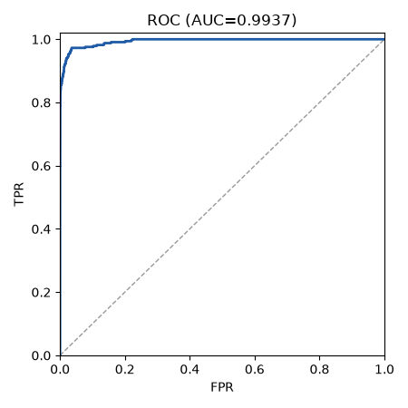
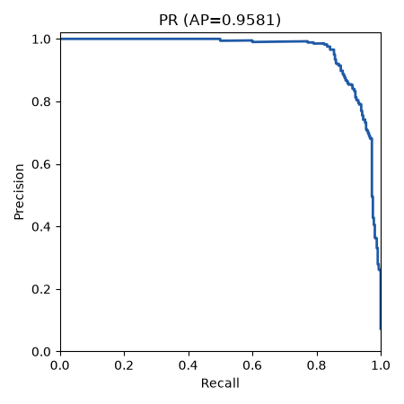
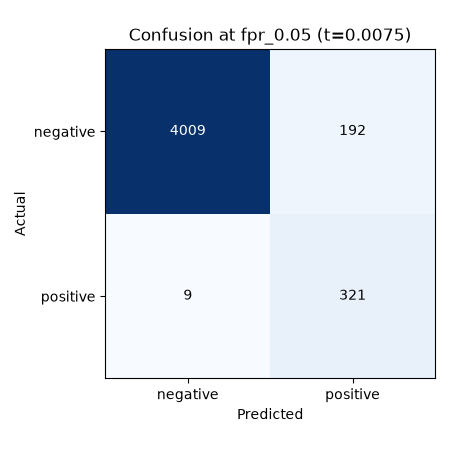
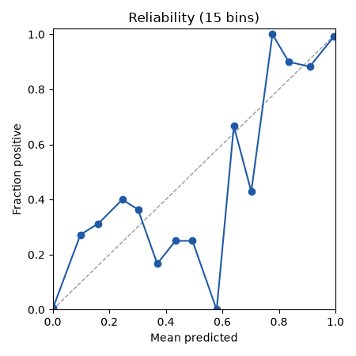

# Run report: char_cnn on test

## Provenance

| Field | Value |
|---|---|
| Run | char_cnn/20261011-015734 |
| Split | test |
| Mode | representatives |
| Seed | 42 |
| Manifest | C:/Users/edani/OneDrive/Documents/Proyectos/Graphito/data/splits/split_v1.json.gz |
| Manifest sha256 | e835362d2e7a4153ef97204d4b30e769759a0f8f54f7db67b9e1fb2639e5238f |
| Calibration sha256 | f150ee19106db13b49c73b80947dc922215780630e193bfdd087c63c72fcd195 |
| Threshold source | calibration:f150ee19106db13b49c73b80947dc922215780630e193bfdd087c63c72fcd195 |
| Git | 9cce24adeacacda88d07f78564390cebef2139dd (dirty: True) |
| Created (UTC) | 2026-10-11T01:57:34.113216+00:00 |

## Threshold-free metrics (observed view)

| Metric | Value | CI95 | n | n_pos | n_neg | Note |
|---|---|---|---|---|---|---|
| roc_auc | 0.9937 | [0.9909, 0.9965] | 4531 | 330 | 4201 |  |
| pr_auc | 0.9581 | [0.9437, 0.9726] | 4531 | 330 | 4201 |  |
| ece | 0.0088 | [0.0069, 0.0123] | 4531 | 330 | 4201 |  |

## Operating points

| Point | Threshold | Source | Target FPR | View | Precision | Recall | FPR | F1 | Support |
|---|---|---|---|---|---|---|---|---|---|
| fpr_0.05 | 0.0075 | calibration:f150ee19106db13b49c73b80947dc922215780630e193bfdd087c63c72fcd195 | 0.0500 | observed | 0.6257 [0.5830, 0.6693] | 0.9727 [0.9559, 0.9886] | 0.0457 [0.0397, 0.0518] | 0.7616 [0.7292, 0.7934] | ok |
| fpr_0.05 | 0.0075 | calibration:f150ee19106db13b49c73b80947dc922215780630e193bfdd087c63c72fcd195 | 0.0500 | balanced | 0.9551 [0.9493, 0.9607] | 0.9727 [0.9559, 0.9886] | 0.0457 [0.0397, 0.0518] | 0.9638 [0.9549, 0.9728] | ok |
| fpr_0.01 | 0.1715 | calibration:f150ee19106db13b49c73b80947dc922215780630e193bfdd087c63c72fcd195 | 0.0100 | observed | 0.8799 [0.8399, 0.9120] | 0.8879 [0.8579, 0.9217] | 0.0095 [0.0069, 0.0128] | 0.8839 [0.8598, 0.9088] | ok |
| fpr_0.01 | 0.1715 | calibration:f150ee19106db13b49c73b80947dc922215780630e193bfdd087c63c72fcd195 | 0.0100 | balanced | 0.9894 [0.9858, 0.9923] | 0.8879 [0.8579, 0.9217] | 0.0095 [0.0069, 0.0128] | 0.9359 [0.9186, 0.9548] | ok |

## Per group (ROC-AUC)

| Breakdown | Group | n | n_pos | AUC | Note |
|---|---|---|---|---|---|
| lang | c | 2136 | 140 | 0.9983 |  |
| lang | cpp | 2395 | 190 | 0.9964 |  |
| course | A2016 | 1103 | 60 | 0.9994 |  |
| course | A2017 | 1033 | 80 | 0.9976 |  |
| course | B2016 | 1461 | 70 | 0.9979 |  |
| course | B2017 | 934 | 120 | 0.9954 |  |
| length_bucket | <512 | 311 | 38 | 0.9968 |  |
| length_bucket | 512-1023 | 756 | 85 | 0.9947 |  |
| length_bucket | 1024-2047 | 1159 | 140 | 0.9930 |  |
| length_bucket | 2048-4095 | 1725 | 56 | 0.9945 |  |
| length_bucket | >=4096 | 580 | 11 | 1.0000 |  |

## Plots

- 
- 
- 
- 

## Limitations

- Student overlap: the split unit is the block (course letter + Zx), not the student, so the same student can appear in train, val and test. Per-student style can leak across splits; treat results as optimistic for unseen students.

## Test view

- headline: test representatives (one file per dup group) (n=4531, n_pos=330)
- Scores: Platt-calibrated `p_synthetic_raw` (calibration fitted on val only)
- Low-support groups (< 30 per class): length_bucket=>=4096 (n=580, n_pos=11)

## Per generator (vs all humans)

Each group's AI files against every human file of the view; low_support when n_pos < 30.

| Breakdown | Group | n_pos | n_neg | ROC-AUC | PR-AUC | recall@fpr_0.05 | recall@fpr_0.01 | Support |
|---|---|---|---|---|---|---|---|---|
| model | codestral | 0 | 4201 | null | null | null | null | low_support |
| model | deepseek-chat | 227 | 4201 | 0.9920 | 0.9409 | 0.9604 | 0.8811 | ok |
| model | gemini-flash | 1 | 4201 | 1.0000 | 1.0000 | 1.0000 | 1.0000 | low_support |
| model | kimi | 1 | 4201 | 1.0000 | 1.0000 | 1.0000 | 1.0000 | low_support |
| model | llama4 | 1 | 4201 | 0.9995 | 0.3333 | 1.0000 | 1.0000 | low_support |
| model | mistral-small | 0 | 4201 | null | null | null | null | low_support |
| model | qwen3 | 100 | 4201 | 0.9974 | 0.9302 | 1.0000 | 0.9000 | ok |
| profile | aplicado | 81 | 4201 | 0.9904 | 0.8831 | 0.9630 | 0.8642 | ok |
| profile | comentado-basic | 26 | 4201 | 0.9862 | 0.8876 | 0.9231 | 0.9231 | low_support |
| profile | comentado-bueno | 37 | 4201 | 0.9916 | 0.8503 | 0.9459 | 0.8108 | ok |
| profile | comentado-malo | 32 | 4201 | 0.9986 | 0.9305 | 1.0000 | 0.9375 | ok |
| profile | comentado-pro | 1 | 4201 | 0.9998 | 0.5000 | 1.0000 | 1.0000 | low_support |
| profile | descuidado | 74 | 4201 | 0.9962 | 0.9129 | 0.9865 | 0.8919 | ok |
| profile | kompaktan | 79 | 4201 | 0.9962 | 0.9164 | 0.9873 | 0.9114 | ok |

## Abstention (reported only)

Files with fewer than 60 non-whitespace normalized chars; they are still scored.

| Split | n | human | ai | total |
|---|---|---|---|---|
| val | 3077 | 12 | 0 | 12 |
| test | 4531 | 20 | 1 | 21 |
| test_all | 9649 | 1333 | 1 | 1334 |

## Shortcut audit

Share of files per class whose raw / normalized text still contains each artifact (report-only; it does not change training or scores). A pattern that remains unbalanced after normalization is a residual shortcut.

### train (human n=10688, ai n=874)

| Pattern | human raw | human normalized | ai raw | ai normalized |
|---|---|---|---|---|
| non_ascii | 0.395 | 0.000 | 0.221 | 0.000 |
| course_marker | 0.380 | 0.000 | 0.003 | 0.000 |
| autotest | 0.180 | 0.000 | 0.000 | 0.000 |
| control | 0.351 | 0.000 | 0.000 | 0.000 |
| cr | 0.337 | 0.000 | 0.000 | 0.000 |
| tab | 0.842 | 0.000 | 0.000 | 0.000 |
| std_prefix | 0.414 | 0.413 | 0.122 | 0.112 |
| using_namespace | 0.066 | 0.066 | 0.364 | 0.364 |
| bits_include | 0.000 | 0.000 | 0.000 | 0.000 |
| non_code_first_line | 0.306 | 0.001 | 0.050 | 0.000 |

| Length bucket (normalized chars) | human | ai |
|---|---|---|
| <512 | 0.093 | 0.129 |
| 512-1023 | 0.264 | 0.259 |
| 1024-2047 | 0.283 | 0.344 |
| 2048-4095 | 0.158 | 0.178 |
| >=4096 | 0.202 | 0.089 |

### test (human n=4201, ai n=330)

| Pattern | human raw | human normalized | ai raw | ai normalized |
|---|---|---|---|---|
| non_ascii | 0.441 | 0.000 | 0.242 | 0.000 |
| course_marker | 0.423 | 0.000 | 0.000 | 0.000 |
| autotest | 0.181 | 0.000 | 0.000 | 0.000 |
| control | 0.384 | 0.000 | 0.000 | 0.000 |
| cr | 0.435 | 0.000 | 0.000 | 0.000 |
| tab | 0.847 | 0.000 | 0.000 | 0.000 |
| std_prefix | 0.462 | 0.460 | 0.242 | 0.236 |
| using_namespace | 0.070 | 0.070 | 0.300 | 0.300 |
| bits_include | 0.000 | 0.000 | 0.003 | 0.003 |
| non_code_first_line | 0.391 | 0.002 | 0.039 | 0.003 |

| Length bucket (normalized chars) | human | ai |
|---|---|---|
| <512 | 0.065 | 0.115 |
| 512-1023 | 0.160 | 0.258 |
| 1024-2047 | 0.243 | 0.424 |
| 2048-4095 | 0.397 | 0.170 |
| >=4096 | 0.135 | 0.033 |
