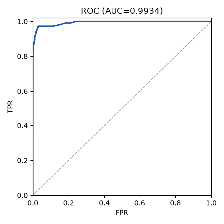
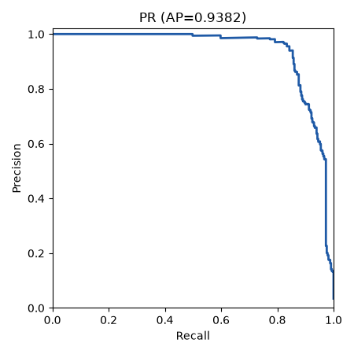
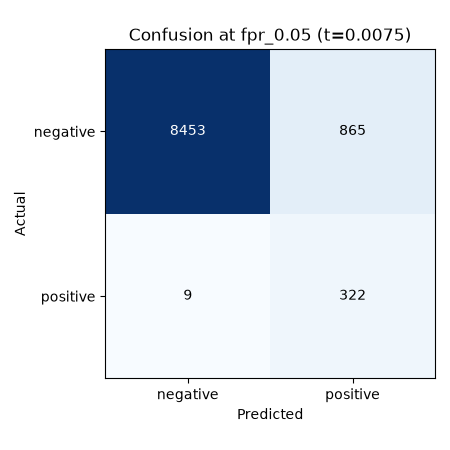
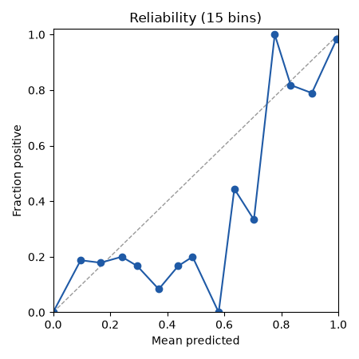

# Run report: char_cnn on test

## Provenance

| Field | Value |
|---|---|
| Run | char_cnn/20261011-015734 |
| Split | test |
| Mode | all_files |
| Seed | 42 |
| Manifest | C:/Users/edani/OneDrive/Documents/Proyectos/Graphito/data/splits/split_v1.json.gz |
| Manifest sha256 | e835362d2e7a4153ef97204d4b30e769759a0f8f54f7db67b9e1fb2639e5238f |
| Calibration sha256 | f150ee19106db13b49c73b80947dc922215780630e193bfdd087c63c72fcd195 |
| Threshold source | calibration:f150ee19106db13b49c73b80947dc922215780630e193bfdd087c63c72fcd195 |
| Git | 9cce24adeacacda88d07f78564390cebef2139dd (dirty: True) |
| Created (UTC) | 2026-10-11T01:57:34.113216+00:00 |

## Threshold-free metrics (observed view)

| Metric | Value | CI95 | n | n_pos | n_neg | Note |
|---|---|---|---|---|---|---|
| roc_auc | 0.9934 | [0.9897, 0.9965] | 9649 | 331 | 9318 |  |
| pr_auc | 0.9382 | [0.9194, 0.9588] | 9649 | 331 | 9318 |  |
| ece | 0.0043 | [0.0030, 0.0067] | 9649 | 331 | 9318 |  |

## Operating points

| Point | Threshold | Source | Target FPR | View | Precision | Recall | FPR | F1 | Support |
|---|---|---|---|---|---|---|---|---|---|
| fpr_0.05 | 0.0075 | calibration:f150ee19106db13b49c73b80947dc922215780630e193bfdd087c63c72fcd195 | 0.0500 | observed | 0.2713 [0.1793, 0.4651] | 0.9728 [0.9563, 0.9886] | 0.0928 [0.0414, 0.1458] | 0.4242 [0.3029, 0.6290] | ok |
| fpr_0.05 | 0.0075 | calibration:f150ee19106db13b49c73b80947dc922215780630e193bfdd087c63c72fcd195 | 0.0500 | balanced | 0.9129 [0.8704, 0.9593] | 0.9728 [0.9563, 0.9886] | 0.0928 [0.0414, 0.1458] | 0.9419 [0.9171, 0.9664] | ok |
| fpr_0.01 | 0.1715 | calibration:f150ee19106db13b49c73b80947dc922215780630e193bfdd087c63c72fcd195 | 0.0100 | observed | 0.7717 [0.7056, 0.8377] | 0.8882 [0.8580, 0.9220] | 0.0093 [0.0061, 0.0130] | 0.8258 [0.7849, 0.8666] | ok |
| fpr_0.01 | 0.1715 | calibration:f150ee19106db13b49c73b80947dc922215780630e193bfdd087c63c72fcd195 | 0.0100 | balanced | 0.9896 [0.9856, 0.9931] | 0.8882 [0.8580, 0.9220] | 0.0093 [0.0061, 0.0130] | 0.9362 [0.9188, 0.9548] | ok |

## Per group (ROC-AUC)

| Breakdown | Group | n | n_pos | AUC | Note |
|---|---|---|---|---|---|
| lang | c | 4338 | 140 | 0.9984 |  |
| lang | cpp | 5311 | 191 | 0.9969 |  |
| course | A2016 | 1428 | 60 | 0.9994 |  |
| course | A2017 | 2910 | 80 | 0.9977 |  |
| course | B2016 | 2817 | 71 | 0.9981 |  |
| course | B2017 | 2494 | 120 | 0.9965 |  |
| length_bucket | <512 | 1912 | 38 | 0.9989 |  |
| length_bucket | 512-1023 | 1494 | 85 | 0.9942 |  |
| length_bucket | 1024-2047 | 2050 | 141 | 0.9929 |  |
| length_bucket | 2048-4095 | 3037 | 56 | 0.9954 |  |
| length_bucket | >=4096 | 1156 | 11 | 1.0000 |  |

## Plots

- 
- 
- 
- 

## Limitations

- Student overlap: the split unit is the block (course letter + Zx), not the student, so the same student can appear in train, val and test. Per-student style can leak across splits; treat results as optimistic for unseen students.

## Test view

- secondary: all non-broken test files (CI95 by dup_group) (n=9649, n_pos=331)
- Scores: Platt-calibrated `p_synthetic_raw` (calibration fitted on val only)
- Low-support groups (< 30 per class): length_bucket=>=4096 (n=1156, n_pos=11)

## Per generator (vs all humans)

Each group's AI files against every human file of the view; low_support when n_pos < 30.

| Breakdown | Group | n_pos | n_neg | ROC-AUC | PR-AUC | recall@fpr_0.05 | recall@fpr_0.01 | Support |
|---|---|---|---|---|---|---|---|---|
| model | codestral | 0 | 9318 | null | null | null | null | low_support |
| model | deepseek-chat | 228 | 9318 | 0.9914 | 0.9181 | 0.9605 | 0.8816 | ok |
| model | gemini-flash | 1 | 9318 | 1.0000 | 1.0000 | 1.0000 | 1.0000 | low_support |
| model | kimi | 1 | 9318 | 1.0000 | 1.0000 | 1.0000 | 1.0000 | low_support |
| model | llama4 | 1 | 9318 | 0.9997 | 0.2500 | 1.0000 | 1.0000 | low_support |
| model | mistral-small | 0 | 9318 | null | null | null | null | low_support |
| model | qwen3 | 100 | 9318 | 0.9978 | 0.9013 | 1.0000 | 0.9000 | ok |
| profile | aplicado | 81 | 9318 | 0.9902 | 0.8514 | 0.9630 | 0.8642 | ok |
| profile | comentado-basic | 26 | 9318 | 0.9848 | 0.8652 | 0.9231 | 0.9231 | low_support |
| profile | comentado-bueno | 37 | 9318 | 0.9901 | 0.8295 | 0.9459 | 0.8108 | ok |
| profile | comentado-malo | 32 | 9318 | 0.9988 | 0.9108 | 1.0000 | 0.9375 | ok |
| profile | comentado-pro | 1 | 9318 | 0.9999 | 0.5000 | 1.0000 | 1.0000 | low_support |
| profile | descuidado | 75 | 9318 | 0.9961 | 0.8858 | 0.9867 | 0.8933 | ok |
| profile | kompaktan | 79 | 9318 | 0.9962 | 0.8813 | 0.9873 | 0.9114 | ok |

## Abstention (reported only)

Files with fewer than 60 non-whitespace normalized chars; they are still scored.

| Split | n | human | ai | total |
|---|---|---|---|---|
| val | 3077 | 12 | 0 | 12 |
| test | 4531 | 20 | 1 | 21 |
| test_all | 9649 | 1333 | 1 | 1334 |
