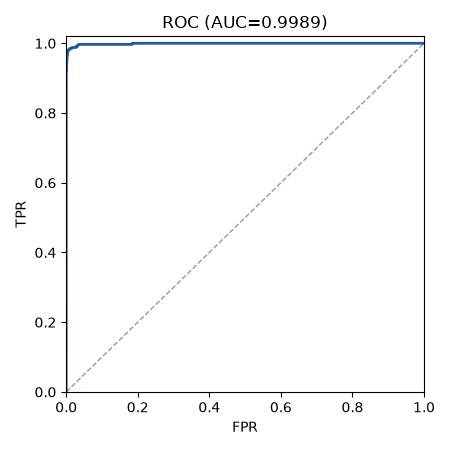
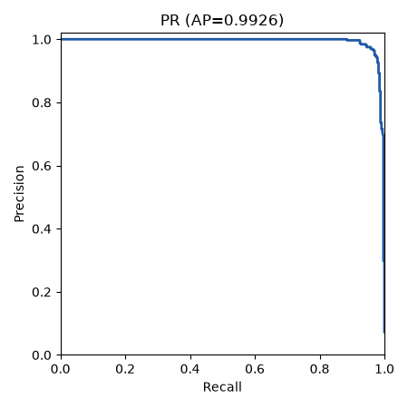
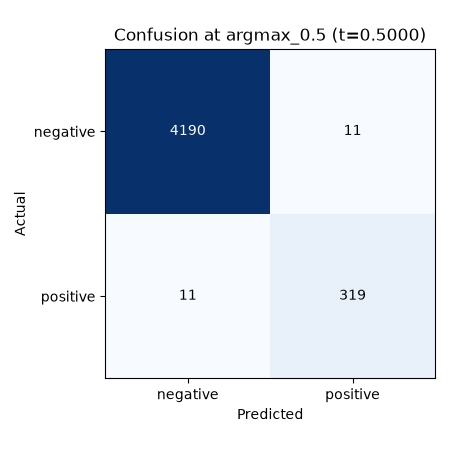
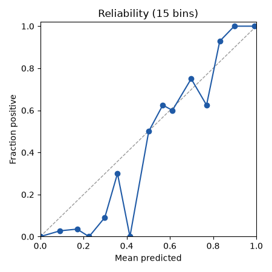

# Run report: char_cnn_legacy on test

## Provenance

| Field | Value |
|---|---|
| Run | char_cnn_legacy/20261011-033124 |
| Split | test |
| Mode | legacy_contaminated |
| Seed | 42 |
| Manifest | C:/Users/edani/OneDrive/Documents/Proyectos/Graphito/data/splits/split_v1.json.gz |
| Manifest sha256 | e835362d2e7a4153ef97204d4b30e769759a0f8f54f7db67b9e1fb2639e5238f |
| Calibration sha256 | null |
| Threshold source | manual |
| Git | 9cce24adeacacda88d07f78564390cebef2139dd (dirty: True) |
| Created (UTC) | 2026-10-11T03:31:24.448110+00:00 |

## Threshold-free metrics (observed view)

| Metric | Value | CI95 | n | n_pos | n_neg | Note |
|---|---|---|---|---|---|---|
| roc_auc | 0.9989 | [0.9977, 0.9997] | 4531 | 330 | 4201 |  |
| pr_auc | 0.9926 | [0.9868, 0.9972] | 4531 | 330 | 4201 |  |
| ece | 0.0061 | [0.0055, 0.0087] | 4531 | 330 | 4201 |  |

## Operating points

| Point | Threshold | Source | Target FPR | View | Precision | Recall | FPR | F1 | Support |
|---|---|---|---|---|---|---|---|---|---|
| argmax_0.5 | 0.5000 | manual | null | observed | 0.9667 [0.9459, 0.9847] | 0.9667 [0.9474, 0.9847] | 0.0026 [0.0012, 0.0043] | 0.9667 [0.9524, 0.9797] | ok |
| argmax_0.5 | 0.5000 | manual | null | balanced | 0.9973 [0.9956, 0.9988] | 0.9667 [0.9474, 0.9847] | 0.0026 [0.0012, 0.0043] | 0.9817 [0.9717, 0.9911] | ok |

## Per group (ROC-AUC)

| Breakdown | Group | n | n_pos | AUC | Note |
|---|---|---|---|---|---|
| lang | c | 2136 | 140 | 0.9977 |  |
| lang | cpp | 2395 | 190 | 0.9996 |  |
| course | A2016 | 1103 | 60 | 0.9999 |  |
| course | A2017 | 1033 | 80 | 0.9969 |  |
| course | B2016 | 1461 | 70 | 0.9993 |  |
| course | B2017 | 934 | 120 | 0.9997 |  |
| length_bucket | <512 | 311 | 38 | 0.9827 |  |
| length_bucket | 512-1023 | 756 | 85 | 0.9966 |  |
| length_bucket | 1024-2047 | 1159 | 140 | 1.0000 |  |
| length_bucket | 2048-4095 | 1725 | 56 | 1.0000 |  |
| length_bucket | >=4096 | 580 | 11 | 1.0000 |  |

## Plots

- 
- 
- 
- 

## Warnings

- contaminated: the legacy checkpoint was trained on a split that overlaps split_v1 test, and its preprocessing (v1) differs from preprocess v2; these numbers are not comparable to a v2 run

## Limitations

- Student overlap: the split unit is the block (course letter + Zx), not the student, so the same student can appear in train, val and test. Per-student style can leak across splits; treat results as optimistic for unseen students.

## Legacy baseline (contaminated)

- contaminated: the legacy checkpoint was trained on a split that overlaps split_v1 test, and its preprocessing (v1) differs from preprocess v2; these numbers are not comparable to a v2 run; not comparable to the legacy 96% claim either.
- Checkpoint: `C:/Users/edani/OneDrive/Documents/Proyectos/Graphito/models/char_cnn/best_model.pth` (sha256 `d3692747d2767b56806964ba2a23e686aa5e8515994d449f6b5e3afb18cb19e7`, unchanged by the run).
- headline: test representatives (one file per dup group) (n=4531, n_pos=330).
- Scores: uncalibrated `prob_sintetico` from the legacy facade; operating point `argmax_0.5` is manual.
- Legacy abstention (`insufficient_length`, scored with the 0.05 placeholder): test 9/4531 (human 8, ai 1), test_all 19/9649 (human 18, ai 1)

## Per generator (vs all humans)

Each group's AI files against every human file of the view; low_support when n_pos < 30.

| Breakdown | Group | n_pos | n_neg | ROC-AUC | PR-AUC | recall@argmax_0.5 | Support |
|---|---|---|---|---|---|---|---|
| model | codestral | 0 | 4201 | null | null | null | low_support |
| model | deepseek-chat | 227 | 4201 | 0.9988 | 0.9906 | 0.9780 | ok |
| model | gemini-flash | 1 | 4201 | 1.0000 | 1.0000 | 1.0000 | low_support |
| model | kimi | 1 | 4201 | 1.0000 | 1.0000 | 1.0000 | low_support |
| model | llama4 | 1 | 4201 | 1.0000 | 1.0000 | 1.0000 | low_support |
| model | mistral-small | 0 | 4201 | null | null | null | low_support |
| model | qwen3 | 100 | 4201 | 0.9993 | 0.9813 | 0.9400 | ok |
| profile | aplicado | 81 | 4201 | 0.9996 | 0.9892 | 0.9753 | ok |
| profile | comentado-basic | 26 | 4201 | 0.9996 | 0.9705 | 0.9615 | low_support |
| profile | comentado-bueno | 37 | 4201 | 1.0000 | 0.9993 | 1.0000 | ok |
| profile | comentado-malo | 32 | 4201 | 1.0000 | 0.9991 | 1.0000 | ok |
| profile | comentado-pro | 1 | 4201 | 1.0000 | 1.0000 | 1.0000 | low_support |
| profile | descuidado | 74 | 4201 | 0.9964 | 0.9584 | 0.9324 | ok |
| profile | kompaktan | 79 | 4201 | 0.9995 | 0.9794 | 0.9620 | ok |
