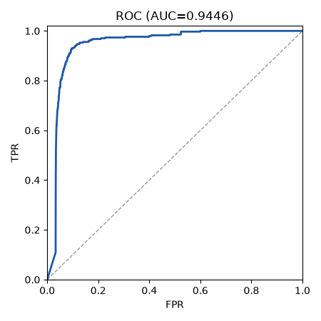
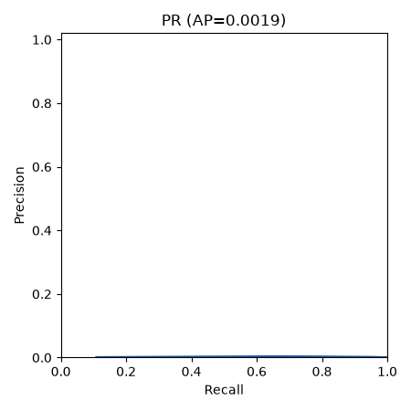

# Run report: graphcodebert on test

## Provenance

| Field | Value |
|---|---|
| Run | graphcodebert/20261011-082155 |
| Split | test |
| Mode | zero_shot |
| Seed | 42 |
| Manifest | data/splits/split_v1.json.gz |
| Manifest sha256 | e835362d2e7a4153ef97204d4b30e769759a0f8f54f7db67b9e1fb2639e5238f |
| Calibration sha256 | null |
| Threshold source | null |
| Git | 69a19d8a3ede60fce5247fe807e98c31657a076e (dirty: False) |
| Created (UTC) | 2026-10-11T08:21:55.689054+00:00 |

## Threshold-free metrics (observed view)

| Metric | Value | CI95 | n | n_pos | n_neg | Note |
|---|---|---|---|---|---|---|
| roc_auc | 0.9446 | [0.9296, 0.9641] | 1908545 | 338 | 1908207 |  |
| pr_auc | 0.0019 | [0.0008, 0.0048] | 1908545 | 338 | 1908207 |  |
| ece | 0.2219 | [0.1982, 0.2612] | 1908545 | 338 | 1908207 |  |
| map_at_r | 0.3736 | [0.1954, 0.5326] |  |  |  |  |

## Operating points

| Point | Threshold | Source | Target FPR | View | Precision | Recall | FPR | F1 | Support |
|---|---|---|---|---|---|---|---|---|---|
| fpr_0.05 | 0.6491 | val_raw_score | 0.0500 | observed | 0.0030 [0.0010, 0.0078] | 0.6095 [0.4653, 0.7019] | 0.0362 [0.0194, 0.0503] | 0.0059 [0.0020, 0.0154] | ok |
| fpr_0.05 | 0.6491 | val_raw_score | 0.0500 | balanced | 0.9439 [0.9152, 0.9693] | 0.6095 [0.4653, 0.7019] | 0.0362 [0.0194, 0.0503] | 0.7407 [0.6204, 0.8082] | ok |
| fpr_0.01 | null | val_raw_score | 0.0100 | - | - | - | - | - | ok; no_threshold_meets_target |

## Plots

- 
- 
- confusion.png not produced: omitted (counts are in metrics.json operating_points)
- reliability.png not produced: scores_not_probabilities

## Warnings

- unachievable: operating point fpr_0.01 has no threshold (no_threshold_meets_target)

## Limitations

- Student overlap: the split unit is the block (course letter + Zx), not the student, so the same student can appear in train, val and test. Per-student style can leak across splits; treat results as optimistic for unseen students.
