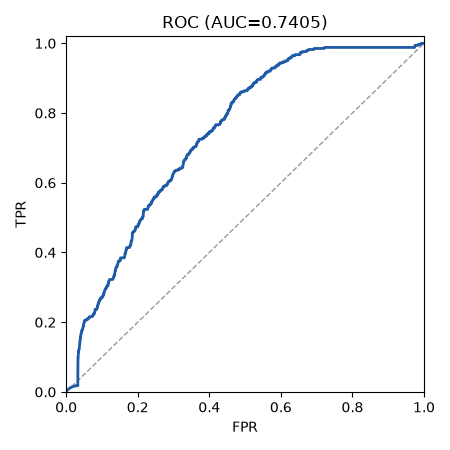
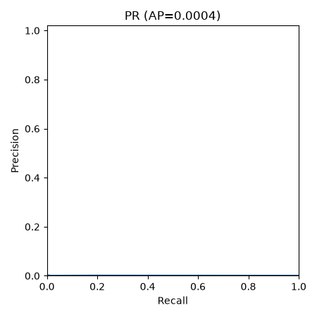

# Run report: graphcodebert on test

## Provenance

| Field | Value |
|---|---|
| Run | graphcodebert/20261011-082155 |
| Split | test |
| Mode | zero_shot |
| Seed | 42 |
| Manifest | data/splits/split_v1.json.gz |
| Manifest sha256 | e835362d2e7a4153ef97204d4b30e769759a0f8f54f7db67b9e1fb2639e5238f |
| Calibration sha256 | null |
| Threshold source | null |
| Git | 69a19d8a3ede60fce5247fe807e98c31657a076e (dirty: False) |
| Created (UTC) | 2026-10-11T08:21:55.689054+00:00 |

## Threshold-free metrics (observed view)

| Metric | Value | CI95 | n | n_pos | n_neg | Note |
|---|---|---|---|---|---|---|
| roc_auc | 0.7405 | [0.6527, 0.7997] | 1908545 | 338 | 1908207 |  |
| pr_auc | 0.0004 | [0.0002, 0.0010] | 1908545 | 338 | 1908207 |  |
| ece | null | null | 1908545 | 338 | 1908207 | scores_not_probabilities |
| map_at_r | 0.1676 | [0.0751, 0.2501] |  |  |  |  |

## Operating points

| Point | Threshold | Source | Target FPR | View | Precision | Recall | FPR | F1 | Support |
|---|---|---|---|---|---|---|---|---|---|
| fpr_0.05 | 0.9920 | val_raw_score | 0.0500 | observed | 0.0004 [0.0001, 0.0013] | 0.0799 [0.0352, 0.1328] | 0.0329 [0.0167, 0.0470] | 0.0009 [0.0002, 0.0025] | ok |
| fpr_0.05 | 0.9920 | val_raw_score | 0.0500 | balanced | 0.7081 [0.5023, 0.8540] | 0.0799 [0.0352, 0.1328] | 0.0329 [0.0167, 0.0470] | 0.1436 [0.0656, 0.2289] | ok |
| fpr_0.01 | 1.0000 | val_raw_score | 0.0100 | observed | 0.0021 [0.0000, 0.0084] | 0.0030 [0.0000, 0.0105] | 0.0002 [0.0002, 0.0003] | 0.0025 [0.0000, 0.0087] | ok |
| fpr_0.01 | 1.0000 | val_raw_score | 0.0100 | balanced | 0.9231 [0.0000, 0.9757] | 0.0030 [0.0000, 0.0105] | 0.0002 [0.0002, 0.0003] | 0.0059 [0.0000, 0.0208] | ok |

## Plots

- 
- 
- confusion.png not produced: omitted (counts are in metrics.json operating_points)
- reliability.png not produced: scores_not_probabilities

## Warnings

- scores_not_probabilities: ECE and reliability are not computed

## Limitations

- Student overlap: the split unit is the block (course letter + Zx), not the student, so the same student can appear in train, val and test. Per-student style can leak across splits; treat results as optimistic for unseen students.
