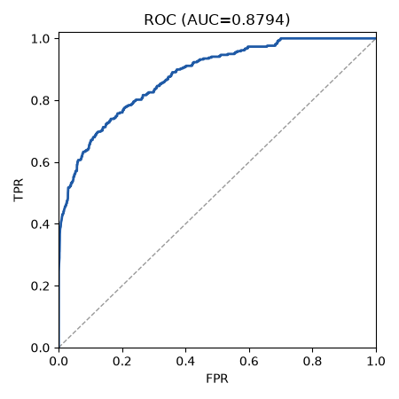
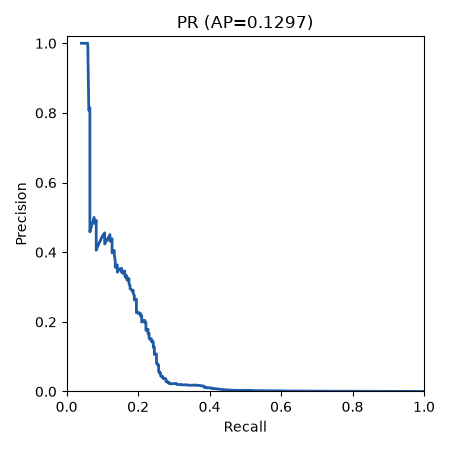

# Run report: graphcodebert on test

## Provenance

| Field | Value |
|---|---|
| Run | graphcodebert/20261011-082155 |
| Split | test |
| Mode | zero_shot |
| Seed | 42 |
| Manifest | data/splits/split_v1.json.gz |
| Manifest sha256 | e835362d2e7a4153ef97204d4b30e769759a0f8f54f7db67b9e1fb2639e5238f |
| Calibration sha256 | null |
| Threshold source | null |
| Git | 69a19d8a3ede60fce5247fe807e98c31657a076e (dirty: False) |
| Created (UTC) | 2026-10-11T08:21:55.689054+00:00 |

## Threshold-free metrics (observed view)

| Metric | Value | CI95 | n | n_pos | n_neg | Note |
|---|---|---|---|---|---|---|
| roc_auc | 0.8794 | [0.8167, 0.9153] | 1846058 | 338 | 1845720 |  |
| pr_auc | 0.1297 | [0.0426, 0.2192] | 1846058 | 338 | 1845720 |  |
| ece | 0.9403 | [0.9257, 0.9606] | 1846058 | 338 | 1845720 |  |
| map_at_r | 0.4360 | [0.3286, 0.5538] |  |  |  |  |

## Operating points

| Point | Threshold | Source | Target FPR | View | Precision | Recall | FPR | F1 | Support |
|---|---|---|---|---|---|---|---|---|---|
| fpr_0.05 | 0.9980 | val_raw_score | 0.0500 | observed | 0.0996 [0.0571, 0.2056] | 0.2515 [0.1358, 0.3373] | 0.0004 [0.0001, 0.0011] | 0.1427 [0.0832, 0.2016] | ok |
| fpr_0.05 | 0.9980 | val_raw_score | 0.0500 | balanced | 0.9983 [0.9967, 0.9994] | 0.2515 [0.1358, 0.3373] | 0.0004 [0.0001, 0.0011] | 0.4018 [0.2392, 0.5042] | ok |
| fpr_0.01 | 1.0000 | val_raw_score | 0.0100 | observed | null null | 0.0000 [0.0000, 0.0000] | 0.0000 [0.0000, 0.0000] | null null | ok |
| fpr_0.01 | 1.0000 | val_raw_score | 0.0100 | balanced | null null | 0.0000 [0.0000, 0.0000] | 0.0000 [0.0000, 0.0000] | null null | ok |

## Plots

- 
- 
- confusion.png not produced: omitted (counts are in metrics.json operating_points)
- reliability.png not produced: scores_not_probabilities

## Limitations

- Student overlap: the split unit is the block (course letter + Zx), not the student, so the same student can appear in train, val and test. Per-student style can leak across splits; treat results as optimistic for unseen students.
