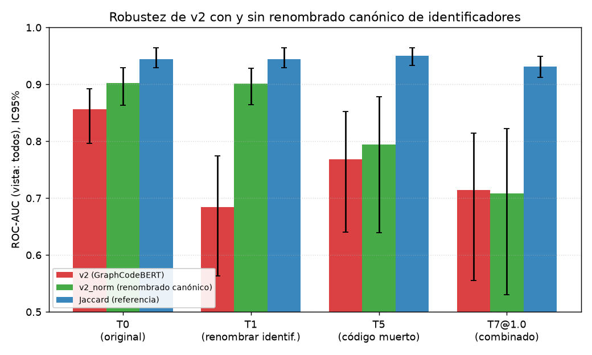

# Robustez de v2 con renombrado canónico de identificadores (`v2_norm`)

- **Corrida:** `20261019-222018`
- **Partición:** `test` (manifiesto `e835362d2e7a4153ef97204d4b30e769759a0f8f54f7db67b9e1fb2639e5238f`)
- **Semilla:** `42`; bootstrap estratificado por asignación; n_boot = 1000 (contrastes primarios) y 1000 en las métricas por condición secundarias.
- **Pregunta:** ¿el renombrado canónico elimina la vulnerabilidad de v2 al renombrado de identificadores (T1) y qué cuesta frente a las demás transformaciones?

## 1. Verificación de reproducción

Se contrastó el ROC-AUC (vista `all`) de esta corrida con la corrida `C:\Users\edani\OneDrive\Documents\Proyectos\Graphito\runs\robustness\20261012-050941` (tolerancia ±0.002).

| Método | Condición | Anterior | Actual | Diferencia | Resultado |
|---|---|---|---|---|---|
| v2 | T0 | 0.8559 | 0.8559 | +0.0000 | OK |
| v2 | T1 | 0.6833 | 0.6844 | +0.0011 | OK |
| jaccard | T0 | 0.9446 | 0.9446 | +0.0000 | OK |
| jaccard | T1 | 0.9446 | 0.9446 | +0.0000 | OK |

Reproducción: **exitosa**.
**Comparación explícita de v2 en T1:** corrida previa (`20261012-050941`) 0.6833; esta corrida 0.6844 (diferencia +0.0011, dentro de ±0.002). Aunque los textos T1 previos no eran reproducibles (la transformación dependía de PYTHONHASHSEED; ver addendum del preregistro), con T1 determinista el resultado de v2 es prácticamente el mismo. T0 de v2 y de jaccard reproducen al cuarto decimal.

## 2. ROC-AUC por método y condición (vista `all`, IC95%)

| Condición | v2 | v2_norm | jaccard |
|---|---|---|---|
| `T0` | 0.856 [0.796, 0.893] | 0.902 [0.863, 0.930] | 0.945 [0.930, 0.964] |
| `T1` | 0.684 [0.563, 0.775] | 0.902 [0.864, 0.928] | 0.945 [0.930, 0.964] |
| `T5` | 0.768 [0.640, 0.852] | 0.794 [0.639, 0.879] | 0.950 [0.933, 0.964] |
| `T7@1.0` | 0.714 [0.555, 0.814] | 0.708 [0.530, 0.823] | 0.931 [0.912, 0.949] |

Cambio respecto de T0 (ΔAUC) con IC95% por bootstrap pareado:

| Condición | v2 | v2_norm | jaccard |
|---|---|---|---|
| `T1` | -0.171 [-0.308, -0.065] | -0.001 [-0.003, 0.001] | +0.000 [-0.000, 0.000] |
| `T5` | -0.087 [-0.212, -0.005] | -0.108 [-0.239, -0.029] | +0.006 [-0.009, 0.016] |
| `T7@1.0` | -0.142 [-0.298, -0.013] | -0.194 [-0.374, -0.054] | -0.013 [-0.032, 0.002] |

## 3. Contraste primario y veredictos preregistrados

Contraste primario: Δ = [AUC_v2_norm(T1) − AUC_v2_norm(T0)] − [AUC_v2(T1) − AUC_v2(T0)], es decir, la fracción de la caída de v2 por renombrado que v2_norm elimina.

**Δ = +0.1710 [0.066, 0.306]** (caída de v2 en T1: -0.1715 [-0.308, -0.065]; caída de v2_norm en T1: -0.0005 [-0.003, 0.001]).

| Hipótesis | Enunciado (preregistro) | Estimación [IC95%] | Veredicto |
|---|---|---|---|
| H1 | La caída de v2_norm en T1 es ≈ 0 (|ΔAUC_v2_norm(T1)| < 0,01) | -0.0005 [-0.003, 0.001] | **CONFIRMADA** |
| H2 | v2_norm en T0 está a menos de 0,02 de v2 en T0 | +0.0463 [0.017, 0.097] | **REFUTADA** |
| H3 (exploratoria) | v2_norm − v2 en T5, sin expectativa previa | +0.0260 [-0.014, 0.060] | Descriptivo |
| H3 (exploratoria) | v2_norm − v2 en T7@1.0, sin expectativa previa | -0.0058 [-0.044, 0.038] | Descriptivo |

Diferencia de nivel v2_norm − v2 por condición (bootstrap pareado, mismo remuestreo):

| Condición | AUC_v2_norm − AUC_v2 [IC95%] |
|---|---|
| `T0` | +0.0463 [0.017, 0.097] |
| `T1` | +0.2173 [0.103, 0.348] |
| `T5` | +0.0260 [-0.014, 0.060] |
| `T7@1.0` | -0.0058 [-0.044, 0.038] |

## 4. Verificación de sanidad: canon(T1(b)) = canon(b)

Sobre 200 segundos archivos de pares positivos muestreados (semilla 42), la igualdad byte a byte se cumple en **188/200 (94.0%)**; T1 modificó el archivo en 200/200 casos.

Discrepancias (primera línea que difiere):

| Archivo | Lenguaje | Línea | Original canónico | T1 canónico |
|---|---|---|---|---|
| `data/raw/src/A2016/Z4/Z2/student2749.c` | c | 133 | `int pozicija=0;` | `int v3=0;` |
| `data/raw/src/A2016/Z4/Z2/student5624.c` | c | 15 | `void f2(char *string, char *v1){ //funkcija koja sifrira string` | `void f2(char *v1, char *v2){ //funkcija koja sifrira string` |
| `data/raw/src/A2016/Z4/Z2/student9071.c` | c | 3 | `char *f1(char *string,char *v1)	//naizgled radi` | `char *f1(char *v1,char *v2)	//naizgled radi` |
| `data/raw/src/A2016/Z4/Z2/student7457.c` | c | 27 | `char* kodiraj(char* v1, char* v2){` | `char* f_6(char* v1, char* v2){` |
| `data/raw/src/A2016/Z4/Z1/student4420.c` | c | 13 | `char* f2(char* string) {` | `char* f2(char* v1) {` |
| `data/raw/src/B2016/Z3/Z2/student5496.cpp` | cpp | 20 | `auto p(v2.find(v5));` | `auto v6(v2.find(v5));` |
| `data/raw/src/A2016/Z4/Z1/student4420.c` | c | 13 | `char* f2(char* string) {` | `char* f2(char* v1) {` |
| `data/raw/src/A2016/Z4/Z1/student3756.c` | c | 11 | `char* f2(char* string) {` | `char* f2(char* v1) {` |
| `data/raw/src/A2016/Z4/Z2/student5624.c` | c | 15 | `void f2(char *string, char *v1){ //funkcija koja sifrira string` | `void f2(char *v1, char *v2){ //funkcija koja sifrira string` |
| `data/raw/src/A2016/Z4/Z1/student4420.c` | c | 13 | `char* f2(char* string) {` | `char* f2(char* v1) {` |
| `data/raw/src/A2016/Z4/Z2/student5624.c` | c | 15 | `void f2(char *string, char *v1){ //funkcija koja sifrira string` | `void f2(char *v1, char *v2){ //funkcija koja sifrira string` |
| `data/raw/src/A2016/Z4/Z2/student9931.c` | c | 3 | `char *f1(char *string,char *v1){` | `char *f1(char *v1,char *v2){` |

**Explicación de las discrepancias (12 filas; algunos archivos se repiten porque se muestrean pares y un mismo segundo archivo aparece en varios):** no son un defecto de T1 sino límites del canonicalizador, que no renombra todo lo que T1 renombra.
- Nombres reservados: T1 renombra identificadores del usuario como `string`, pero el canonicalizador los conserva por estar en su lista de símbolos de biblioteca estándar (`STDLIB_SYMBOLS`); tras T1 aparece `v1` donde el original canónico conserva `string` (student4420, 3756, 5624, 9071, 9931).
- Declaradores no cubiertos por el canonicalizador: la función `kodiraj` (retorno por puntero, student7457) y la variable inicializada con sintaxis de constructor `auto p(...)` (student5496) quedan sin renombrar en el original, mientras T1 sí las renombra a `f_6`/`v6`; también una variable local en student2749.
- Consecuencia: con T1 y canonicalización quedan residuos léxicos en ≈6% de los casos; aun así la caída de v2_norm en T1 es −0.0005 [−0.003, 0.001].
## 5. Limitaciones

- No se recalcula la TPR al umbral desplegado para v2_norm: no existe un umbral calibrado de v2_norm; solo se informa una métrica independiente del umbral (ROC-AUC).
- La canonicalización se aplica después de la transformación y a ambos lados del par; no se evalúa un atacante que conozca la normalización.
- Solo se evalúan T0, T1, T5 y T7@1.0; no se extrapola a T2, T3, T4 ni T6.
- La transformación se aplica al segundo archivo de cada par y, como en la corrida previa, a todos los archivos del conjunto de prueba; hay pocos positivos (n_pos ≈ 338), por lo que los IC son amplios.
- Resultado inesperado respecto del estudio previo (v2_norm ≈ v2 en código ordinario): en T0, v2_norm supera a v2 en +0.046 [0.017, 0.097] sobre el conjunto de prueba, por lo que H2 queda refutada, en el sentido favorable a v2_norm. No se explora la causa aquí.
- Se usó `--skip-validity`: no se midieron tasa de análisis válido ni magnitud de edición de las transformaciones en esta corrida (no afecta los puntajes; la corrida previa los informa). La salida de T0, T5 y T7@1.0 es idéntica a la previa por sha256 en una muestra de 100 archivos.
- n_boot = 1000 en todos los contrastes y condiciones.
## 6. Figura

